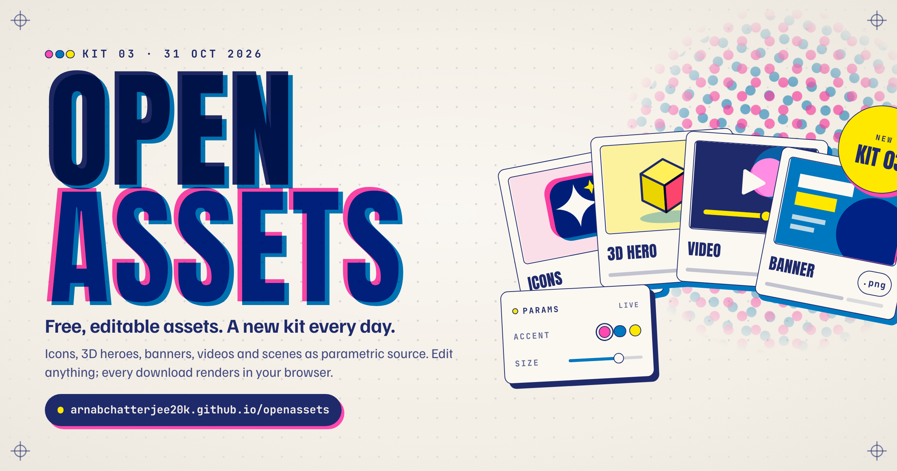

<p align="center">
  <a href="https://arnabchatterjee20k.github.io/openassets/">
    
  </a>
</p>

<p align="center">
  <a href="https://arnabchatterjee20k.github.io/openassets/">
    <picture>
      <source media="(prefers-color-scheme: dark)" srcset="https://shieldcn.dev/group/badge/live-site-ff48b0+badge/new%20assets-3×%20a%20day-0078bf+badge/built%20with-Claude%20Opus%205.5-d97757+badge/renders-in%20your%20browser-111111.svg?variant=secondary&mode=dark" />
      
    </picture>
  </a>
</p>

OpenAssets is a free asset library that grows by one kit a day. Each kit is the set of assets a real team would ship for one job, such as a product launch or a flash sale. Every asset is editable in the browser. You can change its colors, copy and fonts, drop in your own images, switch variants, and download the result.

Claude (Opus 5.5) generates each kit as parametric source code in React, SVG, react-three-fiber and Remotion. The repo stores that source and nothing else. The site draws every preview live, and your browser renders every download from your edits when you click it.

## What a kit contains

- 8 icons built on [Phosphor](https://phosphoricons.com) glyphs. They are solid black by default, with tile, duotone and other variants.
- A 3D hero icon that rests still and reacts when you hover or click it. It exports as PNG, GLB and a 4 second loop.
- Light-beam project cards (592 × 210): a small glossy object per product or feature, lit by coloured beams seeded from the project's name, so every card gets its own light. They export as PNG, GLB and a loop.
- A banner that adapts to Open Graph, X, LinkedIn, YouTube and square sizes.
- 2 video templates for occasions like launches, countdowns and greetings, at 60 fps on a beat grid. They export as MP4.
- An animated isometric scene of the product's idea. It exports as a self-playing animated SVG, a PNG or an MP4 loop.

The header image is the banner from OpenAssets' own launch kit, generated by the same pipeline.

## How a kit gets made

1. `prepare-drop` takes the next use case from `ideas.md` and assigns the least-used palette and type pairing, so kits don't converge on one look.
2. `claude -p` loads the [asset-craft](.claude/skills/asset-craft/SKILL.md) skill and the official Remotion skills, then writes a brief.
3. Claude builds the assets one at a time. After each one it runs `pnpm stills`, opens the contact sheet, writes a critique and fixes what it sees, at least twice per asset.
4. `pnpm validate` typechecks the drop, applies the safety rules, checks every module against the asset contract and smoke-renders every variant in a headless browser.
5. The GitHub Action commits the drop's source and deploys the site to GitHub Pages.

## How rendering works

Gallery cards load their asset module when they scroll near the viewport. Icons and banners render as live DOM. Scenes rest on their first frame and play their SMIL animation on hover. Videos show a Remotion thumbnail and play on hover. 3D cards show a snapshot from one shared offscreen WebGL renderer and become interactive on hover.

Downloads run in the browser. Icons, banners and scene stills rasterise on a canvas. 3D loops and scene loops encode with WebCodecs through [Mediabunny](https://mediabunny.dev). Video templates render with Remotion's web renderer. If a browser can't encode video, the editor offers the template's `props.json` and a `pnpm render:video` command instead.

## Run it locally

```bash
pnpm install
pnpm exec playwright install chromium
pnpm dev                                   # http://localhost:5173

./scripts/test-local.sh                    # validate, test the validator, build
./scripts/test-local.sh --full             # also batch-render the latest kit to out/
```

## Generate a kit

```bash
DATE=2026-11-01 THEME="Podcast Launch" ./scripts/generate.sh
./scripts/regenerate.sh 2026-10-30/scenes/daily-press "fewer, bigger parts"
pnpm stills 2026-10-30/videos/how-openfeed-works --frames 30,120,300
```

`generate.sh` accepts `PALETTE` and `FONTS` to pin a direction, and counts such as `ICONS=8` or `VIDEOS=2`. If the date's kit already exists, the run adds new assets to it in the same theme and direction, and fails if it changes or deletes an existing asset, so you can run it several times a day. `regenerate.sh` redoes one asset through the same skills and review loop, and restores the old asset if validation fails.

## Turn on the daily job

1. Run `claude setup-token` and save the token as the repo secret `CLAUDE_CODE_OAUTH_TOKEN`.
2. In the repo settings, set Pages to deploy from GitHub Actions.
3. Run the "Daily drop" workflow once from the Actions tab to check it.

The job runs at 06:17, 14:17 and 22:17 UTC. The first run of the day starts a new kit and the other two add assets to it. Each run uses Opus 5.5 with a budget of 300 turns. To change what it makes, edit `ideas.md`. To change how it makes it, edit `prompts/daily-drop.md` and the asset-craft skill.

## Safety

Generated code runs in visitors' browsers, so `pnpm validate` rejects network calls, `eval`, dynamic imports, storage APIs, `dangerouslySetInnerHTML`, external URLs and any import outside a short allowlist. In CI, Claude can only edit files inside the day's drop folder, run `pnpm validate` and `pnpm stills`, load skills and read the Remotion docs. `generate.sh` fails the run if any other file changed.

## Credits

Icons use [Phosphor](https://phosphoricons.com) (MIT). Videos use [Remotion](https://www.remotion.dev), which is free for individuals and small teams. Larger companies need a [company license](https://www.remotion.dev/license).
